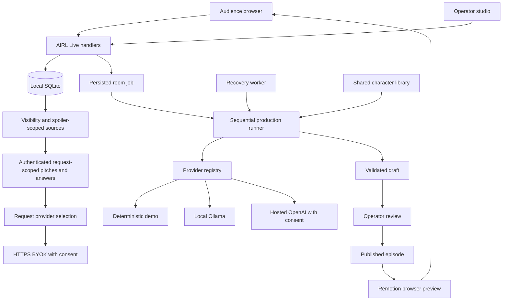
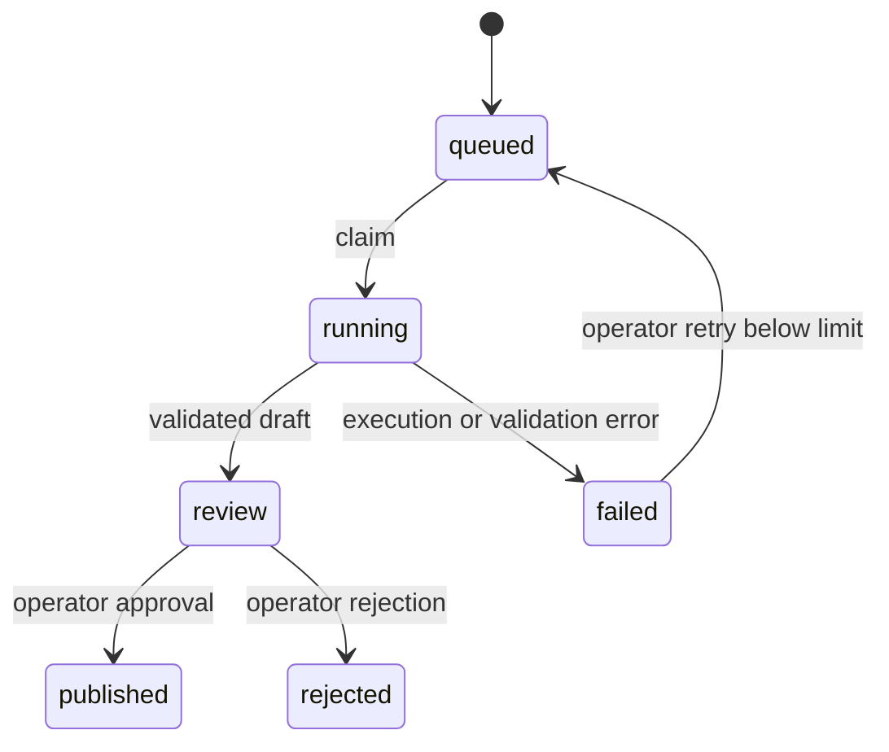

# AIRL architecture and delivery plan

_Last updated November 12, 2026. Latest verified application commit `1731549c43f82ca760a1b814c030c167831afe9f`._

[CHANGELOG.md](CHANGELOG.md) summarizes recent changes. [VERIFICATION.md](VERIFICATION.md) separates current acceptance results from historical checkpoints. The current delivery is Mac-hosted SQLite/Ollama with a public ngrok web tunnel. Supabase, Trigger.dev and cloud media exports remain proposed architecture.

## Current status and proposed redesign

The preservation source reference is `checkpoint/pre-hackathon-ui-pivot-2026-11-12` at original HEAD `fc48254`. The user authorized the first Hackathon UI/UX Optimization frontend sprint from documentation checkpoint `81e975e`. It refines the landing, public navigation, discovery and responsive CSS without changing server APIs, schemas, providers or authentication. The proposed design plan is [UI_UX_PIVOT.md](docs/UI_UX_PIVOT.md) and the review gates are [REDESIGN_ROADMAP.md](docs/REDESIGN_ROADMAP.md). The technical route/provider/lifecycle sections below describe existing code or explicitly labeled future options. Browser acceptance needs an explicit disposable AIRL_LIVE_DB_PATH because playwright.config.ts preserves an inherited value. See README for the safe command.

| Status | Capability | Evidence or boundary |
| --- | --- | --- |
| Implemented and previously verified | Accounts/roles, owned universes, custom cast/relationships, private/public visibility, ordered canon, votes, SSE, jobs/review/publication and Remotion preview | Source contracts and prior tests at `1a7baf3`, retained in VERIFICATION |
| Implemented and previously verified | Offline Demo, real local Ollama, Journey, QR and saved playback | Browser acceptance, real inference and public/device records at their stated checkpoints |
| Partially implemented | Hosted OpenAI and HTTPS BYOK | Adapters, consent/credential isolation and contract tests exist, actual paid inference remains unverified |
| Partially implemented | Reference-image and character visual customization | Protected storage/profile linking exists, upload UI and custom artwork rendering remain future work |
| Frontend increment | Explore-led landing, simplified public navigation, visual universe discovery with local search and genre filters | Existing APIs, permissions, routes and provider contracts retained; see VERIFICATION for new evidence |
| Planned, awaiting review | Numeric traits, character/profile/prompt-policy versions and richer universe identity/preferences | Later product/model proposals, outside this frontend sprint |
| Deferred infrastructure | Supabase Auth/Postgres/RLS/Storage/Realtime, Trigger.dev and always-on hosted execution | Configuration placeholders and architectural options, with separate approval required |
| Deferred product/media | MP4/audio/voice generation, forks, teams and broader moderation | Later bounded milestones |

Current identity uses viewer/creator/admin account roles and anonymous audience sessions. Member is proposed product terminology, with no role-enum or voting-policy migration in this task. [UNIVERSE_MODEL.md](docs/UNIVERSE_MODEL.md) documents current ownership and proposed schema extensions. The singleton-to-universe migration was already implemented and historically applied after verification. No further migration runs in this preservation sprint.

The current publication transaction commits episode, approved canon and final status together. Preview construction precedes Critic completion. Public playback follows approval. This ordering is the runtime preservation contract even when a product diagram narrates continuity after the premiere.

## Multi-universe implementation

The local implementation now includes profiles, viewer/creator/admin roles, optional private interests, owned worlds, public discovery, settings, configurable cast, scoped relationships/assets, ordered episodes/canon, AI pitches and grounded story answers. Local salted scrypt passwords and opaque HttpOnly cookie sessions reuse the existing server architecture. Account recovery and hosted identity hardening remain future work.

`src/server/platform/migration.ts` adds tables transactionally and backfills the official universe while preserving legacy tables and IDs. `scripts/migrate-universes.ts` verifies a SQLite backup before applying to live data. Universe characters use a composite universe/slug key. Asset access and draft retrieval use the same visibility/ownership checks. Archival is recoverable. Characters referenced by production snapshots remain retained.

`src/server/platform/store.ts` owns profile/world/cast/asset access. `src/server/platform/ai.ts` owns pitch inference and pre-inference spoiler-scoped retrieval. `src/ai/providers/stage-contracts.ts` shares live adapter contracts, bounded context, instructions and deterministic manifest assembly. Provider-specific transport stays in Ollama/OpenAI adapters. All stages still validate against the shared production domain.

Closing a round freezes world, cast, approved history, winner, model and explicit story order. Script validation persists the outline. Manifest validation persists a playable version before Critic execution. Compatible retries reuse validated stages and retain the last preview. Publication validates corrected canon and atomically commits the episode, memories, relationships and ordered source events. Repeated publication preserves one result. Public job status omits scripts and private previews.

Story retrieval first filters visibility, universe, optional character and explicit story order. Episode scope excludes later events before inference. Model citations must name supplied source IDs. Definite answers require a citation. This validates source references while semantic grounding still benefits from human review.

### Implemented additional routes

- `/account`, `/universes`, `/universes/[id]`
- `/universes/[id]/episodes`, `/universes/[id]/episodes/[episodeId]`
- `/universes/[id]/characters`, `/universes/[id]/characters/[slug]`
- `/studio/worlds/[id]`, generic `/live/[id]` and scoped historical `?round=` results
- `GET/POST /api/account`, `GET/POST /api/admin`
- `GET/POST /api/universes`, `GET/PATCH/DELETE /api/universes/[id]`
- `POST /api/universes/[id]/{characters,relationships,assets,ask}`, `DELETE .../characters`
- `GET /api/assets/[id]`, `GET /api/models`, `POST /api/pitches`
- Existing live/session/production APIs accept scoped universe identifiers and preserve official defaults.

Private worlds start unpublished. Owners/admins can edit and archive them. Admins grant creator access, and only admins manage official canon. BYOK remains request-only and HTTPS. Hosted models come from a server allowlist, require server enablement and per-operation consent, including explicit paid retries. No provider/model fallback occurs.

Creator-supplied reference images can be stored through the protected image API and linked from character profiles. Custom artwork rendering, audio, forks and team collaboration remain follow-on work. Browser compositions use reusable pictograms and approved CSS backgrounds, including neutral settings.

## 1. Product boundaries

AIRL is the platform. AIRL Live owns audience participation and community decisions. CinemAI owns episodic storytelling and presentation. PersonaAI owns shared character definitions. The provider gateway supplies creative intelligence to these features. The media engine translates validated manifests into playable compositions.

The primary demonstration connects participation, creative workflow, review and published entertainment. QuestAI, RemixAI, WorldForge and AIRL Memories remain discoverable concepts. Expanding them requires their own product and ownership decisions.

## 2. Architecture decisions

- Keep one Next.js App Router repository and a shared TypeScript domain.
- Reuse the existing components, session system, voting implementation, character records and agent schemas.
- Use SQLite as the current local persistence adapter. It requires a persistent writable filesystem. Hosted Vercel execution requires migration to a hosted database.
- Use a server-side provider registry. Ollama qwen3:4b-instruct is the default room-production mode. Operators may select Ollama or explicitly authorize enabled Hosted OpenAI jobs. Paid inference stays behind explicit request consent and server configuration.
- Persist room jobs before executing them. Associate one job with each closed round through a unique constraint.
- Execute sequential creative stages and serialize room jobs locally. Separate publication from generation so operators can review drafts.
- Use the same validated media manifest for preview and later export. Store approved asset IDs and animation enums rather than executable model output.
- Preserve working URLs. Introduce canonical module URLs incrementally, with aliases or redirects when migration is justified.
- Keep public module flags independent from authentication and authorization.
- Support two presentation modes over the same backend: a broad Explore mode and a guided Journey mode for live demos and audience-first storytelling.

## 2.1 Experience mode strategy

Explore mode at `/` and guided Journey at `/journey` share the existing room, production, canon and provider services. `/platform` remains an Explore alias. The root always uses regular AIRL navigation. Journey uses its own full-screen chrome and Exit to Explore action. Existing routes remain available. A shared mode switch carries universe, round, episode, selected step and saved-playback context through URLs. Episode pages supply their stored source round to the switch.

`src/app/journey/page.tsx` validates universe visibility, the selected recorded round and configured room choices. `src/components/journey-demo.tsx` presents five chapters from stored state. Chapter selection is explicit in the URL and remains presenter-controlled during job changes. The vote chapter reuses the live/session/close/next API contracts for authorized presenter actions, with a session revision guard against stale session reads. Audience voting remains on the existing phone page. SSE supplies room changes and production invalidation notices, with five-second presenter and thirty-second audience status fallbacks. Production review reuses `RoomProduction`, and playback/retrieval reuse `EpisodePreview` and `StoryHelper`. Draft fields are fetched through the existing protected production endpoint. Server authorization remains authoritative for every action.

Journey live generation selects Ollama `qwen3:4b-instruct`. The existing Studio selector supports Demo and explicitly consented Hosted OpenAI preparation. Saved fallback reads approved `universe_episodes` manifests with no generation request, keeps the active round job visible and preserves access to the live result. URLs retain the fallback selection through refresh and mode switches.

The tunnel prints separate presenter `/journey` and audience `/live/barangay-2099` addresses. All QR codes encode the selected universe's focused audience route. Journey styling lives in `src/app/journey/journey.css`, using the supplied Manila Hack stone/ink/olive colors and locally bundled Schibsted Grotesk with its SIL Open Font License. CSS supplies ambient motion and recorded-event handoff animation. Generation keeps the active agent central and displays one validated dialogue excerpt or preview version at a time. Native modal sheets in `src/components/journey/sheet.tsx` provide cast, transcripts, authorized review and settings with Tab wrapping, Escape close and restored focus. Preview controls remain shared through `EpisodePreview`, with Journey opting into an external transcript sheet. Layout checks covered 1440 × 900 projector and 390 × 844 phone viewports, including all premiere controls within the stage. [PRESENTER_RUNBOOK.md](PRESENTER_RUNBOOK.md) records the presentation procedure and gated hosted preparation.

## 3. Current implementation map

| Responsibility | Location | Current implementation |
| --- | --- | --- |
| Public routes and metadata | `src/app` | AIRL landing, discovery, module pages and compatible CinemAI URLs |
| Shared navigation and themes | `src/components` | Light, dark and system preference with local persistence |
| Module flags | `src/lib/config` | Public build-time availability settings |
| Accounts, worlds and canon | `src/server/platform` | Profiles, roles, ownership, scoped cast/assets, canon, pitches and story retrieval |
| Permission presentation | `src/server/platform/page.ts`, `src/components/platform/access.tsx` | Server-derived navigation permissions, Studio page guards and immediate signout revocation |
| PersonaAI | `src/features/persona` | Compatible character interfaces backed by approved scoped canon, plus labeled scripted scenarios |
| Live community UI | `src/features/live` | Session join, voting, SSE totals and operator controls |
| Live persistence and auth | `src/server/live` | Scoped SQLite votes/rounds, opaque sessions, account authorization and narrow legacy operator redemption |
| Provider gateway | `src/ai` | Demo, local Ollama, hosted OpenAI and request-scoped creator BYOK |
| Structured workflow | `src/server/production` | Typed stages, bounded revisions, drafts, persistence and room job execution |
| Media preview | `src/video` | Portrait Remotion composition, approved backgrounds, character pictograms and captions |
| Local operator utilities | `scripts` | Admin bootstrap, migration, production CLI, recovery worker, HTTPS/tunnel launchers and load rehearsal |
| Automated checks | `tests` | Voting, provider isolation, workflow, queue and media invariants |

## 4. Component flow

The registry supports four modes. Authenticated pitch, answer and gateway requests have a separate request-scoped path. Creation operations require creator/admin access, while viewers may ask about accessible published stories. Room jobs persist Demo, Ollama or Hosted OpenAI selection together with explicit paid consent where required. BYOK remains request-scoped with operation-specific account permissions. BYOK credentials never enter room jobs.

## 5. Data model

### Local records

| Entity | Important fields and invariants |
| --- | --- |
| `live_sessions` | Hashed token, server role and expiry. Raw cookie token is never stored |
| `live_members` | Unique room/session membership. Counts are cumulative joined sessions |
| `live_rounds` | Room, status and frozen winner. One open round per room |
| `live_options` | Round-scoped option, display position and public choice text |
| `live_votes` | Unique round/session key. Immutable recorded option |
| `room_jobs` | Unique round reference, frozen choice, status, attempt count, run reference and lease |
| `productions` | Execution mode, model, validated input and lifecycle timestamps |
| `events` | Real stage start, success/failure, attempts, outputs and timestamps |
| `production_drafts` | Validated artifact held for review |
| `episodes` | Approved published artifact with a unique production reference |
| `characters` | Preserved legacy character records |
| `accounts`, `account_sessions` | Salted scrypt credentials, viewer/creator/admin roles and opaque session bindings |
| `universes`, `universe_rooms` | Owner, visibility, settings, archival and scoped room identity |
| `universe_characters`, `universe_relationships` | Universe/slug composite identity and scoped relationship references |
| `universe_episodes`, `canon_events` | Explicit story order, source episode/scene and approved canon |
| `universe_assets` | Protected reference-image bytes and universe ownership |
| `production_outlines`, `production_previews` | Validated scripts and versioned playable drafts before Critic completion |
| `job_runs`, `job_failures` | Attempt history and sanitized pre-inference failure records |
| `ai_usage` | Creator-scoped provider metadata, reported tokens, optional estimate and sanitized failure |
| `ai_leases` | Bounded local inference or creator-request lease |

Existing local production files are preserved. Room jobs and their production records share the Live database so publication can commit atomically. CLI mode-specific databases remain available for isolated experimentation.

### Proposed hosted entities

Supabase should normalize profiles, experiences, room memberships, worlds, characters, character memories, rounds, options, votes, jobs, agent events, episodes, media assets, moderation submissions and usage events. Preserve local UUIDs and round/job references during import. Version exported artifacts before introducing incompatible schemas.

Use database transactions or security-definer functions with tightly controlled grants for vote submission, closure, job enqueueing and publication. Add unique indexes before enabling writes. RLS policies must derive identity from Supabase Auth and membership tables. The current SQLite implementation has no Supabase RLS and must not be described as providing it.

## 6. Round and production lifecycle

1. A visitor joins and receives an opaque server-issued session cookie.
2. The backend validates a vote against the round and permitted options.
3. SQLite serializes voting and closure with immediate transactions. Repeat identical votes succeed without adding another record.
4. An authorized world owner/admin or narrow legacy official-room operator closes the round. The highest count wins, with displayed option order breaking ties, including empty rounds.
5. Closure inserts one queued room job in the same transaction. A frozen option title supplies the creative premise.
6. A Next.js `after` callback attempts execution after the HTTP response. An optional local worker drains persisted jobs and recovers expired claims.
7. A claimed job records its real run reference. The existing Director, Screenwriter, Visual Producer and Critic execute with shared schemas.
8. Critic approval produces a persisted draft. This draft remains outside public episode reads and canonical episode history.
9. The creator owner/admin reviews and may correct proposed canon before approval or rejection. Official publication requires admin authority. Approval inserts the episode, approved canon and job/production status atomically.
10. Public audience views retrieve the published manifest and display it through Remotion. Operators can open the next voting round.

### Idempotency and recovery

Unique round/job and run/episode references prevent duplicate publication. Closure and publication tolerate repeated requests. Job claims are serialized and bounded by a lease. A recovered job reuses a completed draft when available. An interrupted run is marked failed before starting a replacement. Each job has at most three production attempts, in addition to bounded per-stage validation retries.

Execution may be attempted again after interruption. Do not promise exactly-once inference. Publication is transactional and idempotent. Room workers execute the persisted provider selection. Hosted inference is gated by server configuration and recorded explicit consent. Before enabling slower or paid workers, introduce renewable leases, fencing tokens, an outbox and provider-aware idempotency policy.

`after` improves local responsiveness but is limited by process and hosting lifetime. The database is the recovery source. The worker command is required to recover persisted work after a process crash. Trigger.dev should replace local scheduling for hosted durable execution while retaining application-owned job/event records.

## 7. Provider and credential boundaries

| Mode | Credential source | Execution | Current restrictions |
| --- | --- | --- | --- |
| Demo | None | Deterministic templates | Clearly labeled simulated agents |
| Ollama | Local server | Sequential loopback inference | Installed models only, single inference lease, unavailable from Vercel localhost |
| Hosted OpenAI | Server environment | Authorized SDK requests | Server enablement, model and explicit request consent |
| Creator BYOK | Page/request memory | Authenticated request scope | HTTPS, consent, strict timeout, no background credentials |

Model limits, context window, request duration and creator request quota are configurable. Optional model rates enable cost estimates. Estimated spend reservations are approximate and can differ from invoices. Exact billing and account-level controls remain provider responsibilities.

Keep raw keys out of cookies, browser storage, URLs, database records, analytics and worker payloads. Disable cloud trace export by default. Do not add provider fallback that can incur charges. Metadata logs should omit prompts and keys. Generated story artifacts belong to explicitly permitted draft/episode storage.

## 8. Media architecture

The browser composition uses 720 × 1280, 30 FPS and three manifest scenes. The default deterministic output lasts 18 seconds. Timings come from the validated manifest. Captions follow the current dialogue segment. Reusable styles include dramatic reveal, dialogue, reaction comedy, news broadcast and cliffhanger.

Approved backgrounds include the plaza, barangay hall, taho stall and neutral settings for custom worlds. Initial character assets reuse licensed Lucide pictograms and existing AIRL styling. Local Draw Things artwork can replace registry entries after authorship, license and visual consistency checks. Model outputs cannot supply arbitrary paths, HTML or code.

Remotion is integrated for local evaluation and browser preview. Its documented free license includes noncommercial evaluation. Confirm organization eligibility before commercial hosting. Larger commercial teams may require a paid license. No license purchase is part of this milestone.

Seeking keeps base scene content visible at exact scene boundaries. Silent previews start muted with no shared audio tags, avoiding a dependency on audio-context resume. Physical iPhone voting, playback, captions and repeated rewind/replay were user-confirmed after these fixes. Safari 16 is explicitly included in the build targets.

MP4 output, FFmpeg encoding, voice tracks, audio mixing, expression sprites and a bounded export queue are later work. Use 1080 × 1920 as the target export size. Share the same composition rather than implementing a second timing engine.

## 9. Current route inventory

| Route | Audience | Purpose |
| --- | --- | --- |
| `/` | Public | Everyday Explore entry, including through the public tunnel |
| `/platform` | Public/visibility-scoped | Explore mode and selected universe |
| `/journey` | Visibility-scoped, presenter controls protected | Five guided stages, live job tracking and saved episode fallback |
| `/discover` | Public | Available and coming-soon experiences |
| `/live` | Public | Room directory |
| `/live/[roomId]` | Public/session | Audience voting, results and approved episodes |
| `/account` | Public/authenticated | Signup, signin, signout and private interests |
| `/universes` | Public/authenticated | Public and personalized discovery |
| `/universes/[id]` | Visibility-scoped | World overview and canon timeline |
| `/universes/[id]/episodes`, `/universes/[id]/episodes/[episodeId]` | Visibility-scoped | Episode library, playback and story helper |
| `/universes/[id]/characters`, `/universes/[id]/characters/[slug]` | Visibility-scoped | Cast, relationships and canon |
| `/studio` | Creator/admin | Owned worlds, creation paths and admin role grants |
| `/studio/worlds/[id]` | Owner/admin | World settings, cast and management |
| `/studio/[roomId]` | Owner/admin or narrow official legacy operator | Voting operations, production events and private review |
| `/studio/ai` | Creator/admin | Provider settings and request previews |
| `/cinemai` | Public | Series entry |
| `/cinemai/watch/[id]` | Public/session | Existing room-oriented episode experience |
| `/cinemai/universe/[id]` | Public | Fictional universe |
| `/persona` | Public | Character directory |
| `/persona/[characterId]` | Public | Profile and labeled scripted scenarios, with authorized creator gateway entry |
| `/watch/[roomId]` | Compatibility | Existing audience route |
| `/universe/[slug]` | Compatibility | Existing universe route |

Registered accessible universes are supported by dynamic wrappers. Unknown and inaccessible private identifiers return 404. Studio pages and actions enforce account roles and universe ownership. Unauthorized direct Studio page requests return 404. Guest/viewer navigation omits management links, creators see their owned-world controls, and admins retain role grants. The server derives layout permissions per request, so the root layout is dynamically rendered. Logout clears privileged UI immediately and authentication refreshes the server permission snapshot. Official canon publication requires an admin. Legacy operator codes grant narrow official-room controls and draft inspection.

### Current API routes

| Method and route | Authorization | Behavior |
| --- | --- | --- |
| GET/POST `/api/account` | Public/current account | Signup/signin/signout and private profile interests |
| GET/POST `/api/admin` | Admin | Account list and viewer/creator grants |
| GET/POST `/api/universes` | Visibility-scoped read, creator/admin create | Catalog and private world creation |
| GET/PATCH/DELETE `/api/universes/[id]` | Visibility-scoped read, owner/admin writes | World settings, publication, archive and restore |
| POST `/api/universes/[id]/{characters,relationships,assets}` | Owner/admin | Cast, relationships and protected reference images |
| DELETE `/api/universes/[id]/characters` | Owner/admin | Remove unreferenced cast member |
| POST `/api/universes/[id]/ask` | Signed-in with source access | Spoiler-scoped story answer, manager-only drafts |
| GET `/api/assets/[id]` | World visibility | Protected image bytes |
| GET `/api/models` | Account | Installed/allowed model discovery |
| POST `/api/pitches` | Creator/admin | Three editable world pitches |
| GET/POST `/api/live/session` | Public/current session | Read or establish scoped anonymous identity |
| POST `/api/live/operator` | Joined session and one-time code | Redeem local creator/operator role |
| GET `/api/live/rooms/[roomId]/state` | World visibility | Aggregate room and current session state |
| GET `/api/live/rooms/[roomId]/events` | World visibility, rechecked | SSE snapshots and content-free production-change notices |
| GET `/api/live/rooms/[roomId]/join-qr` | World visibility | Locally generated QR encoding the same-origin audience room URL |
| POST `/api/live/rooms/[roomId]/vote` | Session | Record a validated vote |
| POST `/api/live/rooms/[roomId]/close` | Owner/admin or narrow legacy operator | Freeze winner and enqueue one job |
| POST `/api/live/rooms/[roomId]/next` | Owner/admin or narrow legacy operator | Start a subsequent round |
| GET `/api/production` | World visibility | Public job status and published manifests |
| GET `/api/production?operator=1` | Owner/admin or narrow legacy operator | Drafts, critic feedback and stage events |
| POST `/api/production` | Owner/admin | Publish, reject or retry, with admin-only official publication |
| GET/POST `/api/ai` | Creator/admin | Provider metadata, explicit tests and request-scoped inference |

## 10. Candidate routes under consideration

These candidates remain future design options. Canonical episode and character pages already exist under `/universes/[id]`.

| Candidate | Purpose | Decision or prerequisite |
| --- | --- | --- |
| `/join/[roomCode]` | Short QR destination | Room slug/code policy and hosted origin |
| `/live/[roomId]/results` | Presentation-only results | Decide whether a separate projector view is needed |
| `/cinemai/series/[seriesId]` | Series archive and branches | Introduce series identity separate from room identity |
| `/cinemai/episodes/[episodeId]` | Possible episode alias | Stable canonical pages already use `/universes/[id]/episodes/[episodeId]` |
| `/cinemai/universe/[worldId]/timeline` | Canon and branch history | Versioned story bible and branch rules |
| `/studio/rooms/new` | Possible standalone room editor | Worlds already create scoped rooms through `/studio` |
| `/studio/[roomId]/production/[jobId]` | Detailed job inspection | Cross-room authorization and job pagination |
| `/studio/[roomId]/moderation` | Review community suggestions | Submission consent and moderation policy |
| `/studio/assets` | Approved media library | Storage ownership, licenses and upload validation |
| `/studio/usage` | Usage and budget administration | Durable creator identity and provider-specific pricing |
| `/settings/ai` | Possible replacement for `/studio/ai` | Choose creator settings versus operator workspace ownership |
| `/profile` | Possible alias for implemented `/account` | Decide whether another URL is useful |
| `/persona/[characterId]/chat` | Dedicated conversation | Consent, private memory and retention policy |
| `/quest`, `/remix`, `/worldforge`, `/memories` | Future modules | Separate bounded feature specifications |

Candidate APIs include `/api/rooms`, `/api/episodes/[episodeId]`, `/api/jobs/[jobId]/events`, `/api/submissions`, an asset-library listing API and `/api/exports`. Protected image reads and scoped uploads already use `/api/assets/[id]` and `/api/universes/[id]/assets`. Introduce them only when their ownership and security contracts are settled. Preserve existing client calls during migration through adapters or compatible handlers.

## 11. Deployment options

### Current local demonstration

Run Next.js on Node 24 with SQLite on a persistent Mac filesystem. Ollama stays on loopback. Browser media previews avoid heavy export processes. Next.js `after` starts the explicitly selected provider job and the optional worker handles recovery. For physical phones, `scripts/demo-lan.mjs` serves the production build over HTTPS on one explicitly assigned private IPv4 address, with strict Host validation and locally generated certificates. Phones trust the public demo CA before opening the Studio QR destination. README.md contains certificate enrollment, launch and recovery instructions. SQLite connections configure a five-second busy timeout at construction, including approved-memory readers.

### Approved hackathon tunnel

For up to 35 audience members, the approved demo keeps Next.js, SQLite and Ollama on the Mac and forwards the web app through ngrok. `scripts/demo-tunnel.mjs` discovers the assigned HTTPS origin, starts `scripts/tunnel-server.mjs` on loopback, launches the existing recovery worker and prevents idle sleep on macOS. The upstream accepts the configured hostname, including its equivalent default HTTPS port, canonicalizes Host and replaces forwarded headers. Public HTTPS account cookies remain Secure and strict same-origin mutation checks apply. Agent request inspection and paid hosted calls are disabled. Ollama is excluded from the upstream port selection.

The live stream keeps its database handles for the connection lifetime, revalidates access each second, sends room snapshots only when changed, and sends content-free production invalidation notices. Gallery/review clients fetch authorized content on notices, with slower fallback polling. This reduces request quota usage while preserving real progress and publication updates. Each stream closes and cleans up its handles on abort, cancellation, revocation or the five-minute connection limit.

`scripts/rehearse-audience.ts` uses separate storage and the actual public endpoint to test 35 audience sessions plus mobile Chrome. It measures HTTP latency, request counts, response/event bytes and sampled process RSS while running the real Ollama pipeline. HTTP/2 sessions reuse connections as browsers do. These are synthetic load measurements and do not replace physical-phone or venue-network rehearsal. Free-plan quotas and the browser notice are documented in README.

### Preferred hosted architecture

Use Next.js/Vercel for web/API, Supabase Auth/PostgreSQL/Realtime/Storage for shared records and Trigger.dev for durable hosted Demo or explicitly authorized server-key jobs. Validate organization eligibility for Remotion. Choose a separate export runtime only when actual rendering requirements justify it.

Vercel functions cannot share the current local SQLite file or access the Mac's localhost Ollama. A secure local-worker bridge would need an explicit device identity, outbound authenticated polling and a separate threat model. Do not expose Ollama publicly as a shortcut.

### Long-lived Node alternative

A compatible persistent Node host can keep SQLite and local scheduling for a small demonstration. File backups, permissions, a single authoritative data directory and process supervision are required. Scale-out and failover favor PostgreSQL and durable queues.

## 12. Migration sequence

1. Preserve the completed local vote → job → review → preview → publication loop, additive world migration, QR sharing and server-side roles.
2. Complete the owner-admin venue rehearsal, repeat crash recovery and monitor repeated-run memory, latency and tunnel allowance.
3. Validate Hosted OpenAI and request-only HTTPS BYOK after credentials and explicit paid-call authorization.
4. If always-on hosting is approved, migrate identity/data/storage to Supabase, preserving UUIDs, story order and transactional invariants. Add adversarial RLS verification before enabling writes.
5. Replace local scheduling with a durable worker and outbox while retaining application-owned job/event records. A Mac-worker bridge needs its own authorization and security design.
6. Add export only after preview correctness, license eligibility and resource profiling. Moderation, team collaboration and forks need separate scopes.

## 13. Acceptance and risk tracking

Verify duplicate submissions, vote/closure races, one job per round, no draft exposure, idempotent approval, replay-safe retries, claim expiry, missing assets, manifest timing and changes based on the winning choice. Verify that old provider IDs and stored episodes remain readable.

Playwright acceptance verifies browser playback, scene seeking, captions and the mobile audience flow for Demo and Ollama. Wider keyboard, reduced-motion and device coverage remain follow-up QA. OpenAI tests remain unverified until credentials and explicit approval are supplied.

Known limits include cookie-recreatable anonymous voting identities, local password accounts without email verification/reset, request-time role snapshots that refresh with navigation/authentication, no hosted RLS, no MP4/audio export and no full content moderation system. Multiple owned universes and scoped rooms are implemented. The Mac, network and ngrok allowance remain demo dependencies. The 35-session result is a short synthetic rehearsal, with one physical iPhone verified separately. Generated quality and cultural consistency still require human review, including on successful local-model runs.

## 14. References

- Next.js scheduling behavior is documented in the installed `node_modules/next/dist/docs/01-app/03-api-reference/04-functions/after.md`.
- Remotion installation and matching package versions are covered in the official Player documentation. [Player installation](https://www.remotion.dev/docs/player/installation)
- Remotion eligibility and evaluation provisions must be checked before commercial deployment. [License FAQ](https://www.remotion.dev/docs/license/faq)
- Ollama structured JSON and local inference follow the official chat API. [Ollama chat API](https://docs.ollama.com/api/chat)
- OpenAI agents retain SDK structured output contracts. [Agent definitions](https://developers.openai.com/api/docs/guides/agents/define-agents)

## Integration sprint revisions

The sprint connects local model inference to the same community job, review and publication path as Demo. A non-destructive migration adds provider mode, selected model, paid consent and requester identity to room jobs. Creator keys remain outside the queue. The worker verifies provider/model access using the existing registry and never substitutes another provider.

Publication checks the artifact's execution mode against both the job and production record. Validated memory updates and the episode commit in the same transaction. Rejection uses a compare-and-set condition on review status, preventing races from reversing publication. Retry transitions are conditional as well.

PersonaAI prompt construction reads approved canonical profiles through src/ai/memory/canonical.ts. Public character details read the same source. Drafts and rejected artifacts are excluded. Room production context includes approved episode history across providers, while standalone CLI compatibility keeps its existing mode-specific history behavior.

The audience episode gallery combines generated and reference episodes. Studio's production surface derives state from real records and displays mode/model, retries and recorded stage transitions. Playwright acceptance uses an isolated production build and database, independent browser contexts and the actual Remotion player.

Automatic hosted inference and any OpenAI smoke test continue to require explicit approval. Local deployment still requires a writable persistent filesystem, and paid billing, long-running cloud jobs and organizational license eligibility remain deployment concerns.
