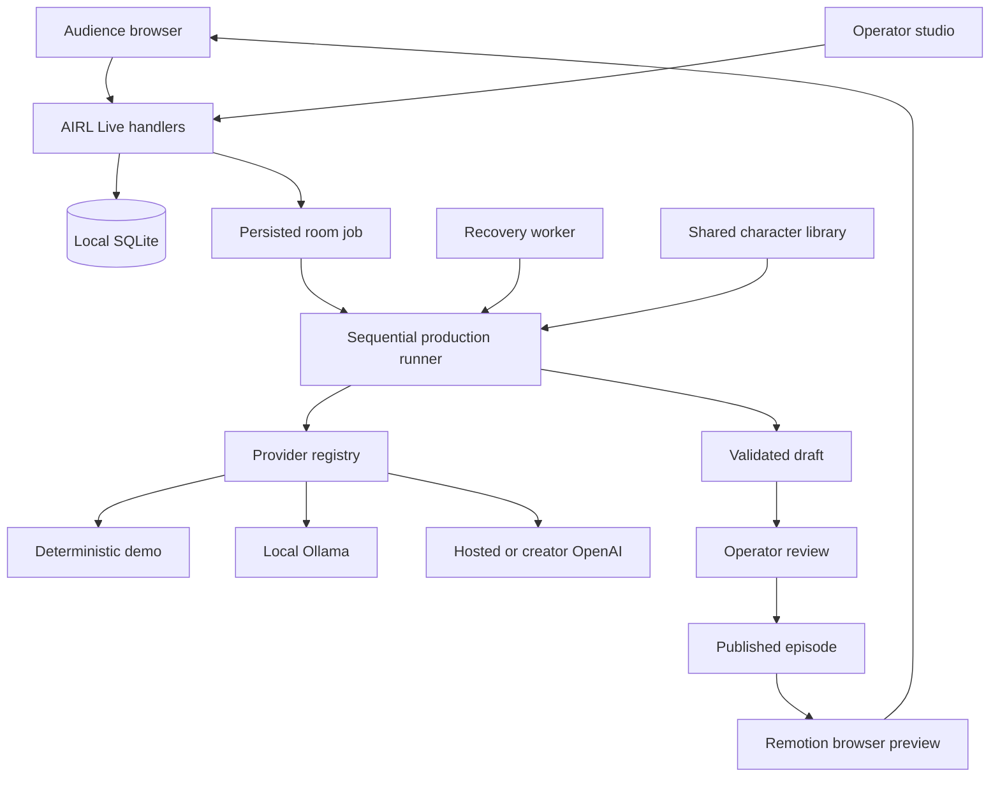
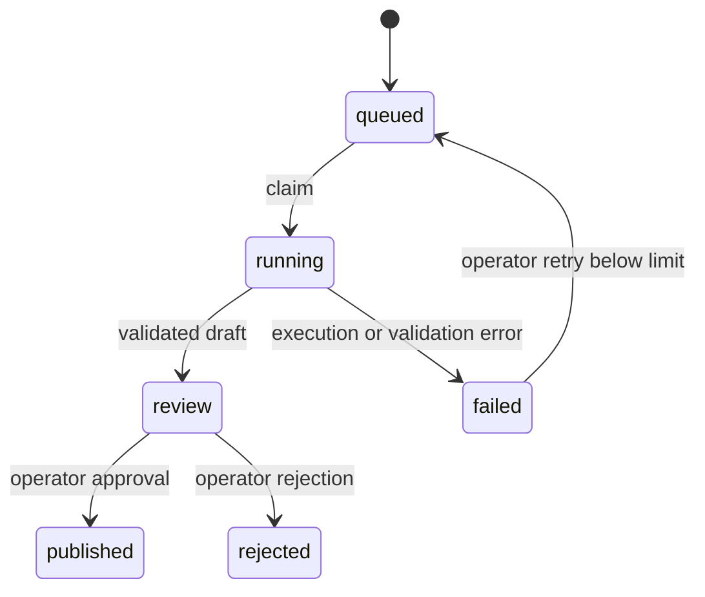

# AIRL architecture and delivery plan

_Last updated November 12, 2026._

## 1. Product boundaries

AIRL is the platform. AIRL Live owns audience participation and community decisions. CinemAI owns episodic storytelling and presentation. PersonaAI owns shared character definitions. The provider gateway supplies creative intelligence to these features. The media engine translates validated manifests into playable compositions.

The primary demonstration connects participation, creative workflow, review and published entertainment. QuestAI, RemixAI, WorldForge and AIRL Memories remain discoverable concepts. Expanding them requires their own product and ownership decisions.

## 2. Architecture decisions

- Keep one Next.js App Router repository and a shared TypeScript domain.
- Reuse the existing components, session system, voting implementation, character records and agent schemas.
- Use SQLite as the current local persistence adapter. It requires a persistent writable filesystem. Hosted Vercel execution requires migration to a hosted database.
- Use a server-side provider registry. Demo is the default room-production mode. Operators may select Ollama or explicitly authorize enabled Hosted OpenAI jobs. Paid inference stays behind explicit request consent and server configuration.
- Persist room jobs before executing them. Associate one job with each closed round through a unique constraint.
- Execute sequential creative stages and serialize room jobs locally. Separate publication from generation so operators can review drafts.
- Use the same validated media manifest for preview and later export. Store approved asset IDs and animation enums rather than executable model output.
- Preserve working URLs. Introduce canonical module URLs incrementally, with aliases or redirects when migration is justified.
- Keep public module flags independent from authentication and authorization.

## 3. Current implementation map

| Responsibility | Location | Current implementation |
| --- | --- | --- |
| Public routes and metadata | `src/app` | AIRL landing, discovery, module pages and compatible CinemAI URLs |
| Shared navigation and themes | `src/components` | Light, dark and system preference with local persistence |
| Module flags | `src/lib/config` | Public build-time availability settings |
| PersonaAI | `src/features/persona` | Shared character profiles, canonical seed memories and scripted scenarios |
| Live community UI | `src/features/live` | Session join, voting, SSE totals and operator controls |
| Live persistence and auth | `src/server/live` | SQLite records, random hashed cookie tokens, local operator redemption |
| Provider gateway | `src/ai` | Demo, local Ollama, hosted OpenAI and request-scoped creator BYOK |
| Structured workflow | `src/server/production` | Typed stages, bounded revisions, drafts, persistence and room job execution |
| Media preview | `src/video` | Portrait Remotion composition, approved backgrounds, character pictograms and captions |
| Local operator utilities | `scripts` | Operator codes, production CLI and recovery worker |
| Automated checks | `tests` | Voting, provider isolation, workflow, queue and media invariants |

## 4. Component flow

The registry supports four modes. Room jobs persist Demo, Ollama or Hosted OpenAI selection together with explicit paid consent where required. BYOK remains limited to creator requests. BYOK credentials never enter room jobs.

## 5. Data model

### Local records

| Entity | Important fields and invariants |
| --- | --- |
| `live_sessions` | Hashed token, server role and expiry. Raw cookie token is never stored |
| `live_members` | Unique room/session membership. Counts are cumulative joined sessions |
| `live_rounds` | Room, status and frozen winner. One open round per room |
| `live_options` | Round-scoped option, display position and public choice text |
| `live_votes` | Unique round/session key. Immutable recorded option |
| `room_jobs` | Unique round reference, frozen choice, status, attempt count, run reference and lease |
| `productions` | Execution mode, model, validated input and lifecycle timestamps |
| `events` | Real stage start, success/failure, attempts, outputs and timestamps |
| `production_drafts` | Validated artifact held for review |
| `episodes` | Approved published artifact with a unique production reference |
| `characters` | Shared character profile and canonical memories |
| `ai_usage` | Creator-scoped provider metadata, reported tokens, optional estimate and sanitized failure |
| `ai_leases` | Bounded local inference or creator-request lease |

Existing local production files are preserved. Room jobs and their production records share the Live database so publication can commit atomically. CLI mode-specific databases remain available for isolated experimentation.

### Proposed hosted entities

Supabase should normalize profiles, experiences, room memberships, worlds, characters, character memories, rounds, options, votes, jobs, agent events, episodes, media assets, moderation submissions and usage events. Preserve local UUIDs and round/job references during import. Version exported artifacts before introducing incompatible schemas.

Use database transactions or security-definer functions with tightly controlled grants for vote submission, closure, job enqueueing and publication. Add unique indexes before enabling writes. RLS policies must derive identity from Supabase Auth and membership tables. The current SQLite implementation has no Supabase RLS and must not be described as providing it.

## 6. Round and production lifecycle

1. A visitor joins and receives an opaque server-issued session cookie.
2. The backend validates a vote against the round and permitted options.
3. SQLite serializes voting and closure with immediate transactions. Repeat identical votes succeed without adding another record.
4. An authenticated operator closes the round. The highest count wins, with displayed option order breaking ties, including empty rounds.
5. Closure inserts one queued room job in the same transaction. A frozen option title supplies the creative premise.
6. A Next.js `after` callback attempts execution after the HTTP response. An optional local worker drains persisted jobs and recovers expired claims.
7. A claimed job records its real run reference. The existing Director, Screenwriter, Visual Producer and Critic execute with shared schemas.
8. Critic approval produces a persisted draft. This draft remains outside public episode reads and canonical episode history.
9. An operator approves or rejects the draft. Approval inserts the episode and changes job/production status atomically.
10. Public audience views retrieve the published manifest and display it through Remotion. Operators can open the next voting round.

### Idempotency and recovery

Unique round/job and run/episode references prevent duplicate publication. Closure and publication tolerate repeated requests. Job claims are serialized and bounded by a lease. A recovered job reuses a completed draft when available. An interrupted run is marked failed before starting a replacement. Each job has at most three production attempts, in addition to bounded per-stage validation retries.

Execution may be attempted again after interruption. Do not promise exactly-once inference. Publication is transactional and idempotent. Room workers execute the persisted provider selection. Hosted inference is gated by server configuration and recorded explicit consent. Before enabling slower or paid workers, introduce renewable leases, fencing tokens, an outbox and provider-aware idempotency policy.

`after` improves local responsiveness but is limited by process and hosting lifetime. The database is the recovery source. The worker command is required to recover persisted work after a process crash. Trigger.dev should replace local scheduling for hosted durable execution while retaining application-owned job/event records.

## 7. Provider and credential boundaries

| Mode | Credential source | Execution | Current restrictions |
| --- | --- | --- | --- |
| Demo | None | Deterministic templates | Clearly labeled simulated agents |
| Ollama | Local server | Sequential loopback inference | Installed models only, single inference lease, unavailable from Vercel localhost |
| Hosted OpenAI | Server environment | Authorized SDK requests | Server enablement, model and explicit request consent |
| Creator BYOK | Page/request memory | Authenticated request scope | HTTPS, consent, strict timeout, no background credentials |

Model limits, context window, request duration and creator request quota are configurable. Optional model rates enable cost estimates. Estimated spend reservations are approximate and can differ from invoices. Exact billing and account-level controls remain provider responsibilities.

Keep raw keys out of cookies, browser storage, URLs, database records, analytics and worker payloads. Disable cloud trace export by default. Do not add provider fallback that can incur charges. Metadata logs should omit prompts and keys. Generated story artifacts belong to explicitly permitted draft/episode storage.

## 8. Media architecture

The browser composition uses 720 × 1280, 30 FPS and three manifest scenes. The default deterministic output lasts 18 seconds. Timings come from the validated manifest. Captions follow the current dialogue segment. Reusable styles include dramatic reveal, dialogue, reaction comedy, news broadcast and cliffhanger.

Approved backgrounds are the plaza, barangay hall and taho stall. Initial character assets reuse licensed Lucide pictograms and existing AIRL styling. Local Draw Things artwork can replace registry entries after authorship, license and visual consistency checks. Model outputs cannot supply arbitrary paths, HTML or code.

Remotion is integrated for local evaluation and browser preview. Its documented free license includes noncommercial evaluation. Confirm organization eligibility before commercial hosting. Larger commercial teams may require a paid license. No license purchase is part of this milestone.

MP4 output, FFmpeg encoding, voice tracks, audio mixing, expression sprites and a bounded export queue are later work. Use 1080 × 1920 as the target export size. Share the same composition rather than implementing a second timing engine.

## 9. Current route inventory

| Route | Audience | Purpose |
| --- | --- | --- |
| `/` | Public | AIRL identity and featured modules |
| `/discover` | Public | Available and coming-soon experiences |
| `/live` | Public | Room directory |
| `/live/[roomId]` | Public/session | Audience voting, results and approved episodes |
| `/studio` | Public shell | Studio navigation and access guidance |
| `/studio/[roomId]` | Public shell, protected actions | Voting operations, production events and review |
| `/studio/ai` | Public shell, creator-protected API | Provider settings and request previews |
| `/cinemai` | Public | Series entry |
| `/cinemai/watch/[id]` | Public/session | Existing room-oriented episode experience |
| `/cinemai/universe/[id]` | Public | Fictional universe |
| `/persona` | Public | Character directory |
| `/persona/[characterId]` | Public | Profile, scripted scenario and provider entry |
| `/watch/[roomId]` | Compatibility | Existing audience route |
| `/universe/[slug]` | Compatibility | Existing universe route |

Only Barangay 2099 is currently supported by dynamic room and universe wrappers. IDs are validated and unknown values return 404. A public studio shell does not grant operator privileges.

### Current API routes

| Method and route | Authorization | Behavior |
| --- | --- | --- |
| GET/POST `/api/live/session` | Public/current session | Read or establish anonymous identity |
| POST `/api/live/operator` | Joined session and one-time code | Redeem local creator/operator role |
| GET `/api/live/rooms/[roomId]/state` | Public | Aggregate room and current session state |
| GET `/api/live/rooms/[roomId]/events` | Public | SSE aggregate snapshots |
| GET `/api/live/rooms/[roomId]/join-qr` | Public | Locally generated QR encoding the same-origin audience room URL |
| POST `/api/live/rooms/[roomId]/vote` | Session | Record a validated vote |
| POST `/api/live/rooms/[roomId]/close` | Operator | Freeze winner and enqueue one job |
| POST `/api/live/rooms/[roomId]/next` | Operator | Start a subsequent round |
| GET `/api/production` | Public | Public job status and published manifests |
| GET `/api/production?operator=1` | Operator | Drafts, critic feedback and stage events |
| POST `/api/production` | Operator | Publish, reject or retry a room job |
| GET/POST `/api/ai` | Creator/operator | Provider metadata, explicit tests and request-scoped inference |

## 10. Candidate routes under consideration

These are proposed designs, not implementation claims.

| Candidate | Purpose | Decision or prerequisite |
| --- | --- | --- |
| `/join/[roomCode]` | Short QR destination | Room slug/code policy and hosted origin |
| `/live/[roomId]/results` | Presentation-only results | Decide whether a separate projector view is needed |
| `/cinemai/series/[seriesId]` | Series archive and branches | Introduce series identity separate from room identity |
| `/cinemai/episodes/[episodeId]` | Stable published episode URL | Public ownership and episode routing model |
| `/cinemai/universe/[worldId]/timeline` | Canon and branch history | Versioned story bible and branch rules |
| `/studio/rooms/new` | Create rooms | Hosted creator identities and room ownership |
| `/studio/[roomId]/production/[jobId]` | Detailed job inspection | Cross-room authorization and job pagination |
| `/studio/[roomId]/moderation` | Review community suggestions | Submission consent and moderation policy |
| `/studio/assets` | Approved media library | Storage ownership, licenses and upload validation |
| `/studio/usage` | Usage and budget administration | Durable creator identity and provider-specific pricing |
| `/settings/ai` | Possible replacement for `/studio/ai` | Choose creator settings versus operator workspace ownership |
| `/profile` | Participant account and preferences | Supabase Auth, privacy and deletion behavior |
| `/persona/[characterId]/chat` | Dedicated conversation | Consent, private memory and retention policy |
| `/quest`, `/remix`, `/worldforge`, `/memories` | Future modules | Separate bounded feature specifications |

Candidate APIs include `/api/rooms`, `/api/episodes/[episodeId]`, `/api/jobs/[jobId]/events`, `/api/submissions`, `/api/assets` and `/api/exports`. Introduce them only when their ownership and security contracts are settled. Preserve existing client calls during migration through adapters or compatible handlers.

## 11. Deployment options

### Current local demonstration

Run Next.js on Node 24 with SQLite on a persistent Mac filesystem. Ollama stays on loopback. Browser media previews avoid heavy export processes. Next.js `after` starts the explicitly selected provider job and the optional worker handles recovery. For physical phones, `scripts/demo-lan.mjs` serves the production build over HTTPS on one explicitly assigned private IPv4 address, with strict Host validation and locally generated certificates. Phones trust the public demo CA before opening the Studio QR destination. README.md contains certificate enrollment, launch and recovery instructions. SQLite connections configure a five-second busy timeout at construction, including approved-memory readers.

### Preferred hosted architecture

Use Next.js/Vercel for web/API, Supabase Auth/PostgreSQL/Realtime/Storage for shared records and Trigger.dev for durable hosted Demo or explicitly authorized server-key jobs. Validate organization eligibility for Remotion. Choose a separate export runtime only when actual rendering requirements justify it.

Vercel functions cannot share the current local SQLite file or access the Mac's localhost Ollama. A secure local-worker bridge would need an explicit device identity, outbound authenticated polling and a separate threat model. Do not expose Ollama publicly as a shortcut.

### Long-lived Node alternative

A compatible persistent Node host can keep SQLite and local scheduling for a small demonstration. File backups, permissions, a single authoritative data directory and process supervision are required. Scale-out and failover favor PostgreSQL and durable queues.

## 12. Migration sequence

1. Finish the local vote → job → review → composition flow and verify retries, restart recovery and publication privacy.
2. Stabilize the world/series/episode identity model and version artifact schemas.
3. Add Supabase migrations and anonymous Auth. Reproduce local transactional constraints and run adversarial RLS tests.
4. Replace local job scheduling with a durable worker using outbox delivery and application-owned event records.
5. Add hosted creator ownership, usage budgets and consented private persona memory.
6. Implement export only after preview correctness, license eligibility and resource profiling are established.
7. Add QR sharing, room management, moderation and accessibility polish for the final demonstration.

## 13. Acceptance and risk tracking

Verify duplicate submissions, vote/closure races, one job per round, no draft exposure, idempotent approval, replay-safe retries, claim expiry, missing assets, manifest timing and changes based on the winning choice. Verify that old provider IDs and stored episodes remain readable.

Playwright acceptance verifies browser playback, scene seeking, captions and the mobile audience flow for Demo and Ollama. Wider keyboard, reduced-motion and device coverage remain follow-up QA. OpenAI tests remain unverified until credentials and explicit approval are supplied.

Known limits include one predefined room, anonymous identities that users can recreate, local session-based creator roles, no hosted RLS, no MP4/audio export and no full content moderation system. Generated quality and cultural consistency still require human review, including on successful local-model runs.

## 14. References

- Next.js scheduling behavior is documented in the installed `node_modules/next/dist/docs/01-app/03-api-reference/04-functions/after.md`.
- Remotion installation and matching package versions are covered in the official Player documentation. [Player installation](https://www.remotion.dev/docs/player/installation)
- Remotion eligibility and evaluation provisions must be checked before commercial deployment. [License FAQ](https://www.remotion.dev/docs/license/faq)
- Ollama structured JSON and local inference follow the official chat API. [Ollama chat API](https://docs.ollama.com/api/chat)
- OpenAI agents retain SDK structured output contracts. [Agent definitions](https://developers.openai.com/api/docs/guides/agents/define-agents)

## Integration sprint revisions

The sprint connects local model inference to the same community job, review and publication path as Demo. A non-destructive migration adds provider mode, selected model, paid consent and requester identity to room jobs. Creator keys remain outside the queue. The worker verifies provider/model access using the existing registry and never substitutes another provider.

Publication checks the artifact's execution mode against both the job and production record. Validated memory updates and the episode commit in the same transaction. Rejection uses a compare-and-set condition on review status, preventing races from reversing publication. Retry transitions are conditional as well.

PersonaAI prompt construction reads approved canonical profiles through src/ai/memory/canonical.ts. Public character details read the same source. Drafts and rejected artifacts are excluded. Room production context includes approved episode history across providers, while standalone CLI compatibility keeps its existing mode-specific history behavior.

The audience episode gallery combines generated and reference episodes. Studio's production surface derives state from real records and displays mode/model, retries and recorded stage transitions. Playwright acceptance uses an isolated production build and database, independent browser contexts and the actual Remotion player.

Automatic hosted inference and any OpenAI smoke test continue to require explicit approval. Local deployment still requires a writable persistent filesystem, and paid billing, long-running cloud jobs and organizational license eligibility remain deployment concerns.
